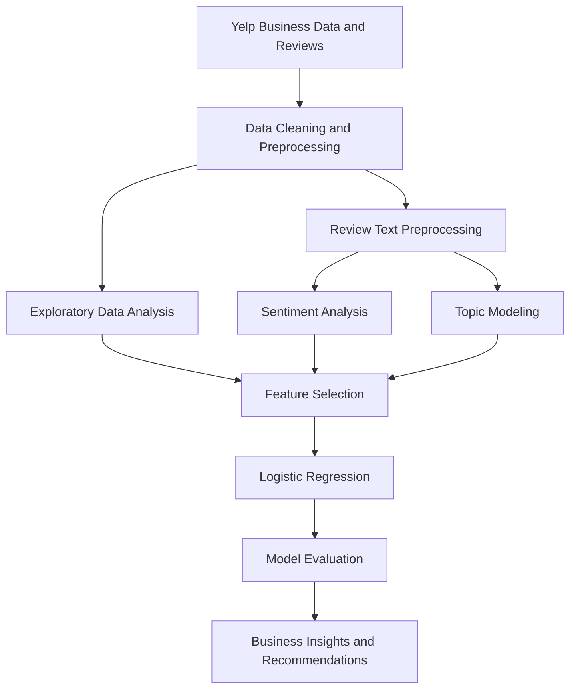

# 🍽️ Predicting Restaurant Business Success in Pennsylvania

### Leveraging Natural Language Processing, Sentiment Analysis, and Machine Learning to Understand Restaurant Performance

<p align="center">
  
  
  
  
</p>

---

## 📌 Project Overview

What makes a restaurant successful? Is it the quality of its food, the service it provides, the atmosphere it creates, or the experiences customers share online?

This project explores these questions through **data-driven analysis of Yelp restaurant businesses, customer reviews, and ratings in Pennsylvania, USA**.

By combining Natural Language Processing (NLP), sentiment analysis, topic modeling, and machine learning, the project investigates customer opinions and develops a predictive approach to classifying restaurant business success.

The goal is to transform unstructured customer feedback into meaningful insights that can help restaurant owners understand customer expectations, identify opportunities for improvement, and make better-informed business decisions.

> **Core idea:** Turn customer reviews into actionable intelligence using NLP and machine learning.

## 🎯 Project Objectives

- Analyze Yelp restaurant data to identify patterns associated with business performance.
- Extract insights from customer reviews using sentiment analysis.
- Discover recurring themes and topics in restaurant feedback.
- Develop a machine learning model to predict restaurant success.
- Investigate the relationship between customer satisfaction, ratings, and restaurant attributes.
- Translate analytical findings into practical recommendations for restaurant businesses.

## ✨ Key Highlights

- 📍 **Geographical focus:** Pennsylvania, USA.
- 📝 **Text analytics:** Analyze customer reviews using NLP techniques.
- 😊 **Sentiment analysis:** Investigate positive, neutral, and negative customer feedback.
- 🔎 **Topic modeling:** Explore recurring themes, including cuisine-related topics.
- 🤖 **Predictive modeling:** Apply logistic regression to classify restaurant success.
- 📊 **Reported model accuracy:** 93.5%.
- 💼 **Business insights:** Explore how customer experiences can inform restaurant improvement strategies.

---

## 🧠 Why This Project Matters

Online reviews influence how customers discover, evaluate, and choose restaurants. They also provide businesses with a valuable source of feedback about their products and services.

However, thousands of reviews can be difficult to analyze manually.

NLP and machine learning provide tools to organize this information, identify recurring patterns, and investigate relationships between customer sentiment and restaurant performance.

| Business Challenge | Analytical Opportunity |
|---|---|
| Large volumes of customer reviews | Automate the analysis of unstructured text |
| Unclear customer satisfaction trends | Summarize positive, neutral, and negative sentiment |
| Recurring complaints or praise | Discover frequently discussed themes |
| Difficulty identifying performance factors | Analyze relationships between reviews, ratings, and business attributes |
| Reactive business decisions | Explore predictive insights to support proactive planning |

These applications can support decision-making, although actual improvements in restaurant performance require validation in real business settings.

---

## 🗂️ Dataset

The project uses Yelp data associated with restaurant businesses in Pennsylvania.

The documented data categories include:

| Data Category | Description | Analytical Purpose |
|---|---|---|
| Business attributes | Restaurant information and available business characteristics | Explore factors associated with business performance |
| Customer reviews | Written feedback from customers | Conduct text preprocessing, sentiment analysis, and topic modeling |
| Customer ratings | Numerical ratings associated with reviews or businesses | Investigate satisfaction patterns and define prediction targets |
| Geographic information | Business locations within Pennsylvania | Support geographically focused analysis |

The exact dataset size, date range, field names, and preprocessing decisions should be documented from the original dataset and code.

**Data note:** Yelp data is subject to its applicable terms and usage restrictions. Verify redistribution permissions before publishing raw datasets or customer review text.

---

## ⚙️ Methodology

The project follows a data science workflow that combines structured business data with unstructured customer feedback.



### 1. Data preprocessing

Prepare the source data for analysis by addressing data quality issues and organizing business attributes, customer ratings, and review text.

Typical preprocessing tasks may include:

- Handling missing or invalid values.
- Checking duplicate records.
- Standardizing relevant fields.
- Preparing numerical and categorical attributes.
- Cleaning review text before NLP processing.

The specific operations should be confirmed against the implementation.

### 2. Exploratory Data Analysis (EDA)

Explore the dataset to understand its characteristics and identify patterns relevant to restaurant performance.

Potential analysis areas include:

- Distribution of restaurant ratings.
- Review volume across businesses.
- Customer sentiment distribution.
- Relationships between available business attributes and ratings.
- Differences across restaurant categories or locations.

EDA helps establish a foundation for feature selection and model development.

### 3. Natural Language Processing

Customer reviews contain unstructured information about restaurant experiences.

Text preprocessing can prepare these reviews for analysis through operations such as tokenization, normalization, and removal of irrelevant text.

The processed text can then be used to investigate sentiment and recurring discussion themes.

### 4. Sentiment analysis

Sentiment analysis examines the emotional polarity expressed in customer feedback.

The project's reported analysis identifies the following distribution:

| Sentiment | Reported Share |
|---|---:|
| Positive | 77% |
| Neutral | 16% |
| Negative | 6% |

These percentages are the reported figures from the project description. They sum to 99%, potentially because of rounding or an unreported category; the original analysis should be checked before treating them as an exhaustive distribution.

Sentiment analysis can help identify general satisfaction patterns and areas that may deserve closer investigation.

### 5. Topic modeling

Topic modeling is used to investigate recurring themes in customer reviews.

The project reports identifying cuisine-related themes, including Mexican and sushi restaurants.

Topic modeling can help reveal what customers frequently discuss, such as cuisine preferences, food quality, service, or dining experiences, depending on the patterns present in the source data.

The specific topics and their importance should be interpreted from the actual model outputs rather than assumed in advance.

### 6. Feature selection

Relevant business attributes, ratings, and text-derived features can be considered for predictive modeling.

Feature selection should account for the prediction objective and the timing of available information.

For example, if the goal is to predict future success, using reviews or ratings collected after the prediction date could introduce data leakage.

### 7. Predictive modeling

The project uses **Logistic Regression** to predict restaurant business success.

Logistic regression is a supervised learning algorithm that estimates the probability of a categorical outcome based on input features.

For binary classification, the model can be represented as:

\[
P(y=1\mid x)=\frac{1}{1+e^{-(w^Tx+b)}}
\]

Where:

- \(x\) represents the input features.
- \(w\) represents the learned feature coefficients.
- \(b\) is the intercept.
- \(P(y=1\mid x)\) is the estimated probability of the positive class.

The definition of restaurant success must be established before training. In this project, success is described in terms of average customer ratings and review sentiment.

### 8. Model evaluation

The model's performance is assessed using the reported accuracy metric.

A more comprehensive evaluation should include precision, recall, F1-score, a confusion matrix, and ROC-AUC where appropriate.

The evaluation should also document how the target labels were created, how the data was split, and whether model performance was assessed on previously unseen businesses.

---

## 📊 Results and Findings

### Predictive model performance

<box gap={1}>
  <box border radius="xl" padding={4} gap={1}>
    <text color="secondary" weight="medium" size="sm">Reported Logistic Regression Accuracy</text>
    <title size="2xl" color="success">93.5%</title>
    <box background="surface-tertiary" radius="full" height="10px" clip>
      <box background="#0D9488" height="10px" radius="full" width="93.5%"/>
    </box>
    <text color="secondary" size="xs">Reported project result; independent verification and evaluation details are not provided here.</text>
  </box>
</box>

The reported experiment achieved **93.5% accuracy** when predicting restaurant success using logistic regression.

This result suggests that the selected features were able to distinguish between the project's defined outcome classes in its evaluation setup. The reliability and generalizability of the result depend on the target definition, dataset split, class balance, and prevention of data leakage.

### Key analytical findings

- **Customer sentiment:** The reported review analysis was predominantly positive.
- **Recurring themes:** Topic modeling identified cuisine-related topics, including Mexican and sushi.
- **Customer experience:** The project highlights ambiance and service quality as important areas associated with positive customer experiences.
- **Predictive potential:** The reported logistic regression result supports further investigation of Yelp data for restaurant performance analysis.

The relationship between these factors and business success should not be interpreted as causal without additional evidence.

---

## 💡 Business Recommendations

### 1. Monitor customer feedback continuously

Analyze new reviews regularly to identify changes in customer sentiment and emerging issues.

### 2. Improve service quality

Investigate recurring complaints about staff interactions, waiting times, and order accuracy where supported by the review data.

### 3. Evaluate the dining experience

Examine feedback about ambiance, comfort, cleanliness, and other aspects of the dining experience when these themes appear in the data.

### 4. Refine menu offerings

Use recurring cuisine preferences and customer feedback to guide further investigation into menu improvements and product offerings.

### 5. Use data-driven decision-making

Combine review analysis with relevant operational and business information before making significant decisions.

### 6. Validate predictions before acting

Treat model predictions as decision-support signals rather than guarantees of future restaurant performance. Test recommendations against real-world outcomes before scaling them.

---

## 🛠️ Technology Stack

The following tools are suitable for the described workflow. Confirm the actual dependencies against the project's notebooks and source code.

| Technology | Purpose |
|---|---|
| Python | Data processing and model development |
| Pandas | Structured data manipulation |
| NumPy | Numerical computation |
| Scikit-learn | Logistic regression and model evaluation |
| NLP libraries | Review text preprocessing and analysis |
| Matplotlib | Data visualization |
| Seaborn | Statistical visualization |
| Jupyter Notebook | Interactive experimentation and analysis |

The exact NLP library and topic modeling technique should be documented after verifying the implementation.

---

## 🚀 Getting Started

### Prerequisites

- Python installed on your system.
- Git installed and configured.
- Access to the required Yelp dataset.
- Jupyter Notebook or another environment capable of running the project's Python files.

### 1. Clone the repository

```bash
git clone https://github.com/esana1/Predicting-Restaurant-Success-PA.git
```

### 2. Navigate to the project directory

```bash
cd Predicting-Restaurant-Success-PA
```

### 3. Create a virtual environment

```bash
python -m venv .venv
```

Activate the environment on Windows:

```bash
.venv\Scripts\activate
```

On macOS or Linux:

```bash
source .venv/bin/activate
```

### 4. Install dependencies

If a `requirements.txt` file is included:

```bash
pip install -r requirements.txt
```

If no dependency file is present, inspect the notebooks and scripts to identify the required packages.

### 5. Configure the dataset

Place the authorized Yelp data files in the expected location and update file paths if necessary.

Avoid committing credentials, restricted datasets, or private customer information.

### 6. Run the project

Open the repository's existing Jupyter notebooks or Python scripts and follow the documented execution order.

**Reproducibility note:** Add the verified notebook names, dataset paths, dependency versions, and execution commands to make the project easier for other developers to run.

---

## 🌱 Future Enhancements

### Advanced NLP models

Compare traditional text-processing techniques with TF-IDF features, word embeddings, or transformer-based sentiment analysis.

### Model comparison

Evaluate logistic regression against other suitable classification algorithms and compare their performance under the same validation setup.

### Explainable machine learning

Investigate feature coefficients and appropriate explainability methods to understand which inputs contribute to model predictions.

### Temporal prediction

Explore whether historical reviews and ratings can predict later outcomes, using time-based validation to prevent future information from leaking into training.

### Interactive analytics dashboard

Build a dashboard that presents sentiment trends, topic distributions, restaurant characteristics, and model evaluation metrics.

### Stronger generalization testing

Evaluate the model on separate businesses or time periods and examine performance across different geographic areas and restaurant categories.

---

## ⚠️ Limitations

- Restaurant success is a project-defined outcome and may not reflect financial profitability or long-term business survival.
- The reported accuracy does not establish performance on unseen data without details of the evaluation methodology.
- Yelp reviews may not represent the experiences of all restaurant customers.
- Sentiment and topic modeling can misinterpret sarcasm, context, and domain-specific language.
- Observed associations between review themes and restaurant performance do not establish causation.

## 📌 Conclusion

This project demonstrates how customer reviews and business data can be combined with NLP and machine learning to investigate restaurant performance.

By exploring sentiment, identifying recurring review themes, and applying logistic regression, the project provides a foundation for turning unstructured feedback into structured analytical insights.

The broader lesson is that **customer feedback is more valuable when it can be systematically analyzed, evaluated, and translated into informed business decisions**.

---

## ⭐ Explore the Project

If you find this project useful, consider starring the repository, exploring its implementation, or contributing improvements to its analysis and reproducibility.

<p align="center">
  <strong>Understand customer voices. Discover meaningful patterns. Make data-driven decisions.</strong>
</p>
